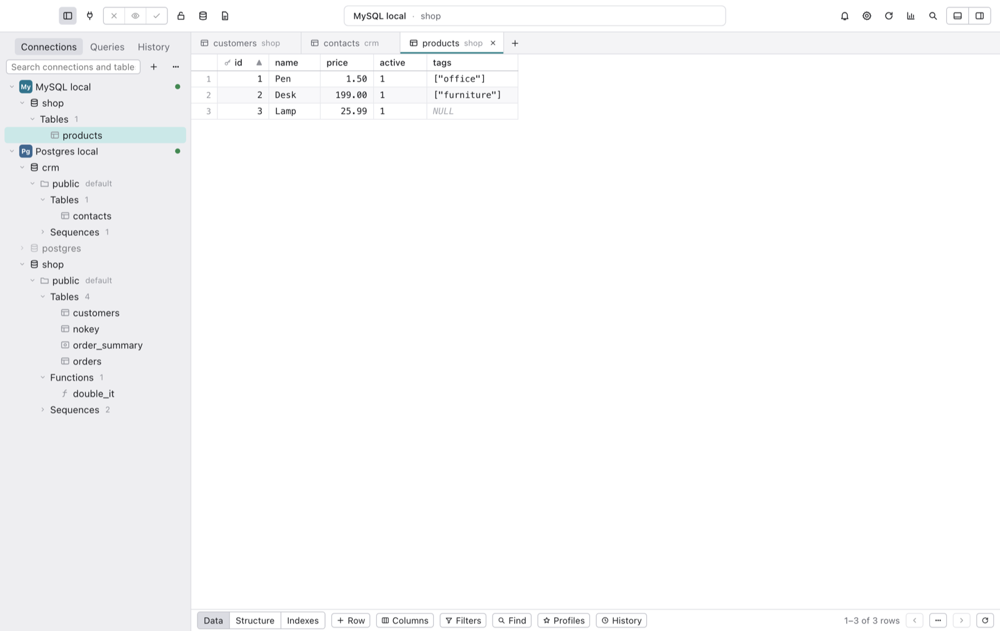
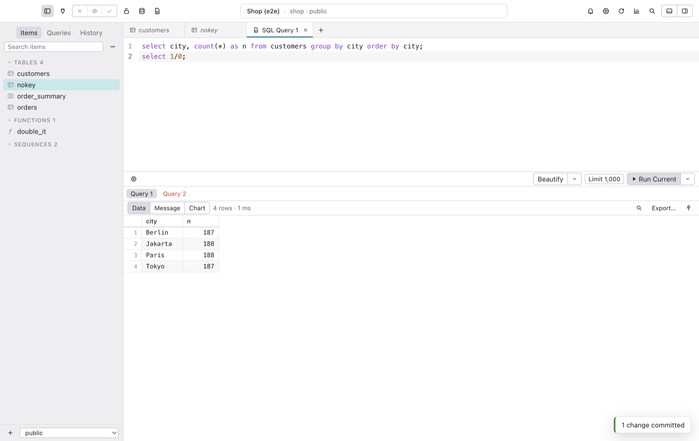
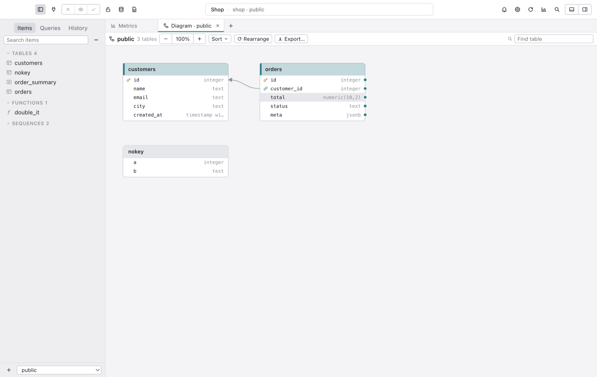
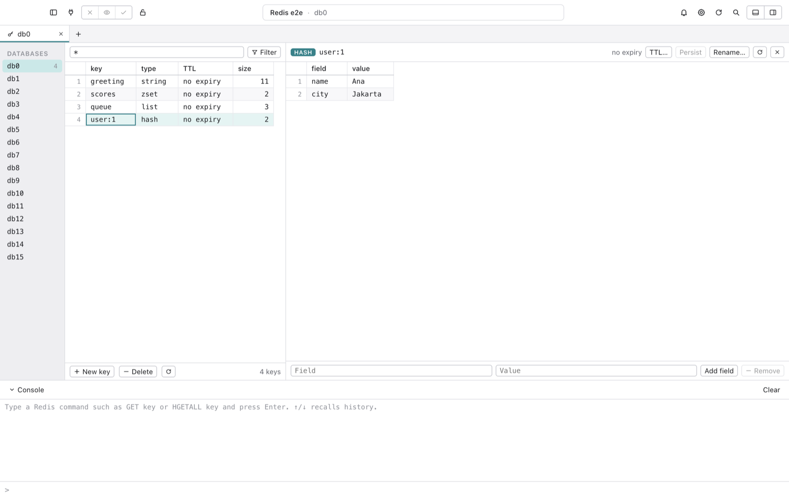
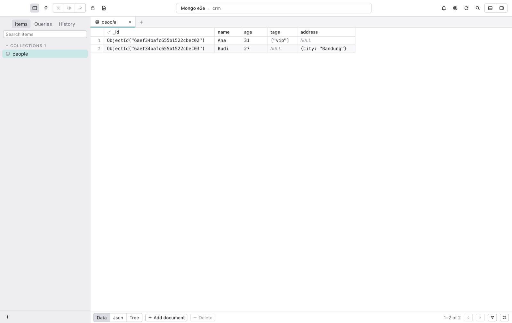

<p align="center">
  
</p>

<h1 align="center">Lagoon</h1>

<p align="center">
  <strong>Database client yang tenang dan cepat untuk PostgreSQL, MySQL, MariaDB, SQLite, Redis, dan MongoDB.</strong>
</p>

<p align="center">
  <a href="https://github.com/ramdanegie/lagoon/releases"></a>
  
  
  
  <a href="LICENSE"></a>
</p>

<p align="center">
  <a href="README.md">English</a> · Bahasa Indonesia
</p>

---

Lagoon adalah app desktop untuk bekerja dengan database. Semua koneksi ada di satu jendela: buka database mana pun dari pohon dan kerjakan beberapa sekaligus. Menjelajah tabel, mengedit baris langsung di grid, menulis SQL, mengubah struktur, impor dan ekspor, backup, dan memantau server, semuanya dari satu jendela yang tenang.

Setiap perubahan di grid atau di editor struktur **ditahan dulu**. Kamu bisa melihat SQL persisnya, lalu commit dalam satu transaksi, atau membatalkannya. Safe mode menambahkan konfirmasi atau password sebelum apa pun menyentuh database produksi.

Semuanya gratis dan open source. Tanpa akun, tanpa telemetri, tanpa batasan fitur: tab, jendela, filter, dan dashboard tanpa batas.

<p align="center">
  
</p>

## Fitur unggulan

- 🌳 **Satu jendela, semua database.** Pohon koneksi di kiri: koneksi → database → schema → tabel. Double-click database dan langsung terbuka di tempat; tabel dan query dari koneksi serta database berbeda berjajar sebagai tab, masing-masing diberi label databasenya dan memakai sesinya sendiri. Klik **Tables** untuk melihat ringkasan semua tabel beserta jumlah baris dan ukurannya, bisa diurutkan per kolom.
- 🔌 **Koneksi yang langsung jalan.** PostgreSQL, MySQL, MariaDB, SQLite, Redis, dan MongoDB. SSH tunnel dengan key, `~/.ssh/config`, dan SSH agent (host key diingat sejak koneksi pertama), SSL/TLS dengan sertifikat klien. Password disimpan di keychain OS, ditanya setiap kali, atau diambil dari perintah shell untuk token berumur pendek. Warna status, tag, grup bertingkat, impor dari URL, dan ekspor terenkripsi untuk dibagikan ke tim. Pindah dari app lain? Impor koneksi dari TablePlus, DBeaver (beserta password yang tersimpan), atau file ekspor Navicat `.ncx`.
- 📋 **Grid yang tetap mulus.** Rendering virtual menggulir 10.000 baris di 120 fps. Edit langsung di grid: klik sel yang sudah terpilih, tekan `F2` atau `Enter`, atau langsung ketik; sel yang diedit menampilkan ✓ untuk menyimpan dan ✗ untuk batal. Record bar di bawah grid menambah (+) dan menghapus (−) baris, lalu menyimpan (✓) atau membuang (✗) semua perubahan. `⌘I` menambah baris, `⌘D` menduplikasi, `⌫` menghapus. Perubahan diberi warna (baru, diubah, dihapus) sampai kamu menekan `⌘S`. Hasil `SELECT` dari satu tabel yang memuat key-nya bisa diedit dan disimpan dengan cara yang sama. Pilih nilai foreign key dari tabel induk, cari dan ganti di satu halaman, simpan susunan filter dan kolom sebagai profil. Undo dan redo, sidebar detail baris yang bisa mengedit banyak baris sekaligus, Quick Look untuk teks panjang, JSON, dan gambar, lompat ke foreign key dengan sekali klik, salin sebagai CSV, JSON, Markdown, HTML, atau perintah `INSERT`.
- 🔍 **Filter tanpa batas.** Kolom apa pun, semua operator (`IN`, `BETWEEN`, `LIKE`, contains, prefix, `ILIKE` di Postgres…), pencarian "semua kolom", kondisi SQL mentah, AND atau OR, quick filter dari sel. Filter, urutan, kolom tersembunyi, dan lebar kolom diingat per tabel.
- 🧱 **Editor struktur.** Kolom, tipe, default, primary key, foreign key dengan `ON UPDATE`/`ON DELETE`, index, trigger, dan DDL lengkap. Buat tabel, view, materialized view, function, dan procedure. Semuanya ditampilkan sebagai SQL sebelum dijalankan.
- ⌨️ **Editor SQL yang enak dipakai.** Jalankan statement di bawah kursor (`⌘↩`) atau semuanya (`⇧⌘↩`), satu tab hasil per statement, autocomplete yang paham alias, saran JOIN dari foreign key, arahkan kursor ke tabel untuk melihat kolomnya, snippet dengan tab stop, banyak kursor, mode Vim, beautify dan uglify, parameter query dalam enam gaya, batas baris, chart dari hasil apa pun, saved query sebagai file `.sql` biasa dengan shortcut kata kunci, buka file `.sql` apa pun lewat `⌘O`, Finder, atau Open With, dan riwayat yang bisa dicari per koneksi.
- 🛡️ **Safe mode.** Lima level per koneksi, dari diam sampai "password sebelum setiap perubahan". Berlaku untuk editor, commit grid, kill query, backup, dan dashboard.
- 🧭 **Open Anything.** `⌘P` melompat ke tabel, view, function, database, saved query, atau fitur mana pun. Ditambah pencarian nilai di semua tabel dalam database.
- 🔄 **Sinkronisasi dan transfer.** Salin tabel antar koneksi, bahkan lintas engine (PostgreSQL ⇄ MySQL ⇄ SQLite) atau ke file SQL. Data sync membandingkan baris berdasarkan key, menunjukkan setiap perbedaan sampai ke sel, dan hanya men-deploy baris yang kamu centang. Structure sync membandingkan dua skema lalu menuliskan skrip migrasinya, urut sesuai dependensi.
- 🔬 **Visual Explain.** Lihat query plan sebagai pohon, dengan langkah yang mahal disorot serta statistik per langkah dan per tabel. Explain Analyze menjalankan perintah tulis di dalam transaksi yang di-rollback.
- 🧪 **Data uji dan dokumentasi.** Isi tabel dengan data palsu yang realistis dan menghormati foreign key (induk lebih dulu), keunikan, dan enum, lengkap dengan preview dan seed. Ekspor data dictionary skema sebagai HTML atau Markdown.
- 🗺️ **ER diagram.** Tabel, kolom, dan foreign key, dikelompokkan dengan warna. Tarik antar kolom untuk membuat foreign key, lalu commit seperti perubahan lainnya.
- 📦 **Impor, ekspor, backup.** Impor CSV, JSON, dan SQL dengan pemetaan kolom dan penanganan konflik. Ekspor ke CSV, JSON, SQL (gzip), dan Excel. Backup dan restore dengan `pg_dump`/`pg_restore` dan `mysqldump`/`mysql`, lengkap dengan log langsung.
- 📊 **Dashboard.** Metrics board berisi tabel, scoreboard, chart batang, garis, dan pie, input, dropdown, dan tombol yang saling terhubung lewat `$variabel`, refresh otomatis dari 1 detik sampai 30 menit.
- 👥 **Alat server.** Manajemen user dan hak akses untuk PostgreSQL dan MySQL, serta process list untuk menemukan dan menghentikan query yang lambat.
- 🧰 **Redis dan MongoDB yang digarap serius.** Redis: semua indeks database, pencarian key, editor untuk string, hash, list, set, sorted set, dan stream, TTL, serta konsol perintah. MongoDB: tampilan grid, JSON, dan tree, edit bertahap, dan shell untuk `find`, `aggregate`, dan perintah database.
- 🧭 **Tur fitur.** Tur singkat dengan sorotan ke bagian-bagian utama jendela saat pertama dibuka. Hapus centang "Show this tour when Lagoon opens" agar tidak muncul lagi, dan putar ulang kapan saja dari Help ▸ Feature Tour.
- 🧩 **Sesuaikan sesukamu.** Plugin JavaScript, tema terang dan gelap plus tema buatanmu, ukuran font, editor keymap, dan kunci passcode app.

<p align="center">
  
  
</p>
<p align="center">
  
  
</p>

## Ringan di Mac-mu

Lagoon dibangun dengan Electron, tetapi disetel agar tetap kecil. Diukur di Mac Apple Silicon dengan `node test/perf/measure.mjs --compare` (memori seperti yang ditampilkan Activity Monitor, semua proses dijumlahkan):

| | Diam | Satu tabel 10.000 baris terbuka | Scroll |
|---|---|---|---|
| **Lagoon** | **126 MB** | 196 MB | 120 fps |
| Navicat Premium Lite 17.3.11 | 129 MB | – | – |

Caranya: driver database, SSH, ekspor Excel, editor SQL, dan chart baru dimuat saat pertama kali dipakai; editor, chart, dan setiap dialog baru dimuat saat dibuka; grid hanya merender baris yang terlihat di layar; raster di CPU menjaga proses GPU tetap kecil tanpa mengurangi frame. App Swift native seperti TablePlus masih lebih hemat (sekitar 60 MB saat diam); Lagoon menukar sedikit memori dengan kemampuan berjalan di macOS, Windows, dan Linux dari satu basis kode.

## Instalasi

1. Unduh rilis terbaru untuk platformmu dari [Releases](https://github.com/ramdanegie/lagoon/releases): `.dmg` untuk macOS (`arm64` untuk Apple Silicon, `x64` untuk Intel), `-setup.exe` untuk Windows, `.AppImage` atau `.deb` untuk Linux.
2. macOS: buka DMG lalu seret **Lagoon** ke **Applications**. Build rilis belum dinotarisasi, jadi macOS belum bisa memverifikasinya: buka **System Settings → Privacy & Security** lalu klik **Open Anyway** (atau jalankan `xattr -dr com.apple.quarantine /Applications/Lagoon.app`).
3. Windows: jika SmartScreen menampilkan "Windows protected your PC", klik **More info → Run anyway**.

**Kebutuhan:** macOS 12 atau lebih baru (Apple Silicon atau Intel), Windows 10 atau lebih baru, atau desktop Linux terbaru.

## Build dari source

```bash
git clone https://github.com/ramdanegie/lagoon.git
cd lagoon
npm install
npm run dev          # jalankan dengan hot reload
npm run build:mac    # atau build:win / build:linux → dist/
```

Butuh Node 22 atau lebih baru. `npm run icon` membuat ulang semua ukuran ikon dari [`docs/design/Lagoon App Icon.html`](docs/design/Lagoon%20App%20Icon.html).

## Test

```bash
npm test                         # unit test: generator SQL, pemisah statement, URL, grant, impor/ekspor, plugin…
./test/e2e/fixtures.sh up        # Postgres, MySQL, Redis, MongoDB, dan SQLite sementara (tidak menyentuh server milikmu)
npm run e2e                      # build app lalu dijalankan otomatis dengan Playwright
node test/e2e/engines.mjs        # satu putaran uji per engine database
./test/e2e/fixtures.sh down
node test/perf/measure.mjs       # waktu buka, memori, dan waktu frame saat scroll
```

## Privasi

- Semuanya lokal: tanpa telemetri, tanpa analitik, tanpa akun, tanpa server. Lagoon hanya berbicara dengan database yang kamu sambungkan.
- Password dienkripsi dengan keychain OS (`safeStorage`) dan tidak pernah ditulis ke disk dalam bentuk teks biasa. Jika penyimpanan aman tidak tersedia, Lagoon menolak menyimpannya.
- Host key SSH diingat saat koneksi pertama; key yang berubah akan memblokir koneksi.
- Plugin berjalan dengan izinmu dan bisa membaca serta mengubah datamu. Pasang hanya plugin yang kamu percaya.

## Pintasan keyboard

| Aksi | macOS | Windows / Linux |
|---|---|---|
| Open Anything | `⌘P` | `Ctrl+P` |
| Buka database / koneksi | `⌘K` / `⇧⌘K` | `Ctrl+K` / `Ctrl+Shift+K` |
| Query SQL baru | `⌘E` | `Ctrl+E` |
| Jalankan statement aktif / semua | `⌘↩` / `⇧⌘↩` | `Ctrl+Enter` / `Ctrl+Shift+Enter` |
| Commit / Preview / Batalkan | `⌘S` / `⇧⌘P` / `⇧⌘⌫` | `Ctrl+S` / `Ctrl+Shift+P` / `Ctrl+Shift+Backspace` |
| Filter / Kolom | `⌘F` / `⌥⌘F` | `Ctrl+F` / `Ctrl+Alt+F` |
| Tambah baris / Duplikat | `⌘I` / `⌘D` | `Ctrl+I` / `Ctrl+D` |
| Detail baris | `Space` | `Space` |
| Process list / batalkan query | `⌘.` | `Ctrl+.` |
| Settings | `⌘,` | `Ctrl+,` |

Semua pintasan bisa diubah di **Settings → Keymap**.

## Struktur proyek

| Path | Isinya |
|---|---|
| `src/main` | Proses utama Electron: driver database, SSH tunnel, penyimpanan lokal (`node:sqlite`), job, plugin |
| `src/main/drivers` | Driver PostgreSQL, MySQL/MariaDB, SQLite, Redis, dan MongoDB |
| `src/shared` | Logika murni yang teruji: generator SQL per dialek, pemisah statement, parser URL, SQL grant |
| `src/renderer` | UI React: grid, editor, layar, tema |
| `plugins-examples` | Tiga contoh plugin sebagai titik awal |
| `docs/design` | Sumber ikon app (satu file HTML merender semua ukuran) |
| `test` | Unit test, suite end-to-end Playwright, fixture, dan alat ukur performa |

## Kontribusi

Issue dan pull request sangat diterima, dari laporan bug sampai engine database baru.

- Jalankan `npm test` dan `npm run typecheck` sebelum membuka PR.
- Perubahan ke database selalu lewat alur perubahan bertahap atau safe mode. Jangan menambah jalur yang mengirim perubahan tanpa salah satunya.
- Simpan logika pembuatan SQL di `src/shared`, dengan test untuk setiap dialek yang disentuh.

Kalau Lagoon berguna untukmu, ⭐ membantu orang lain menemukannya.

## Pembuat

Dibuat oleh **Egie Ramdan** · [github.com/ramdanegie](https://github.com/ramdanegie)

## Lisensi

[MIT](LICENSE)
