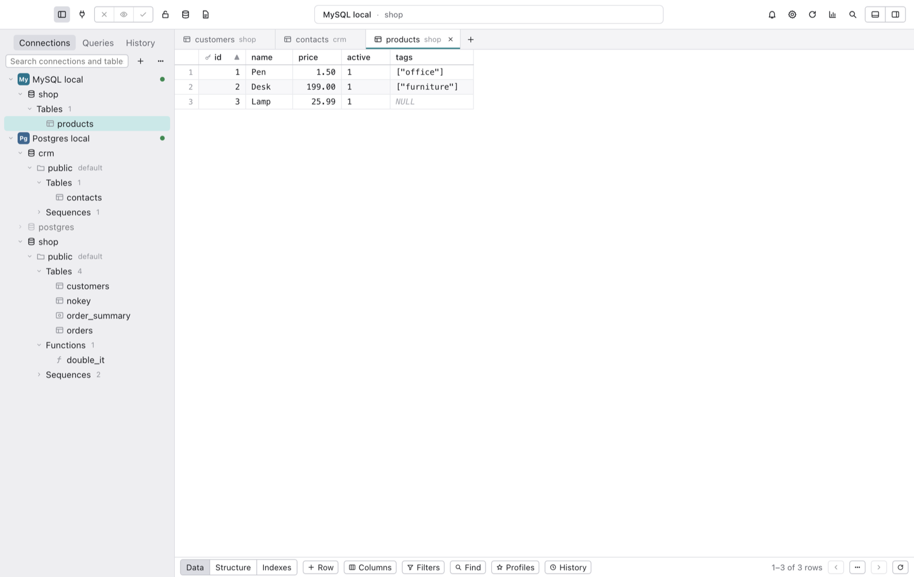
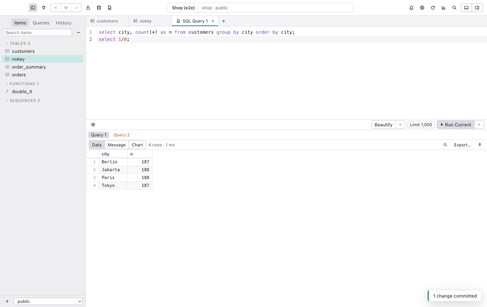
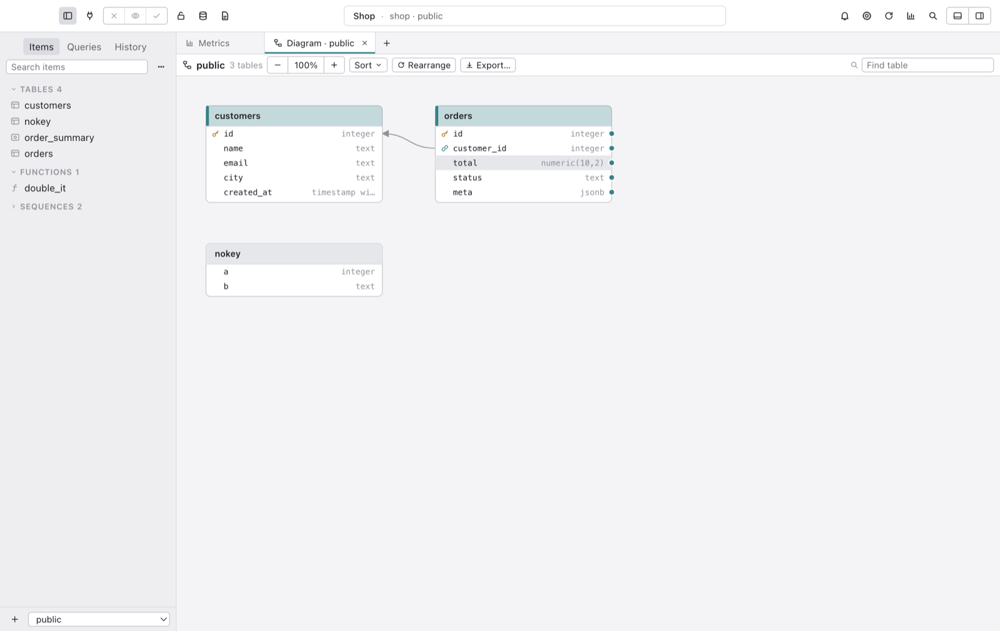
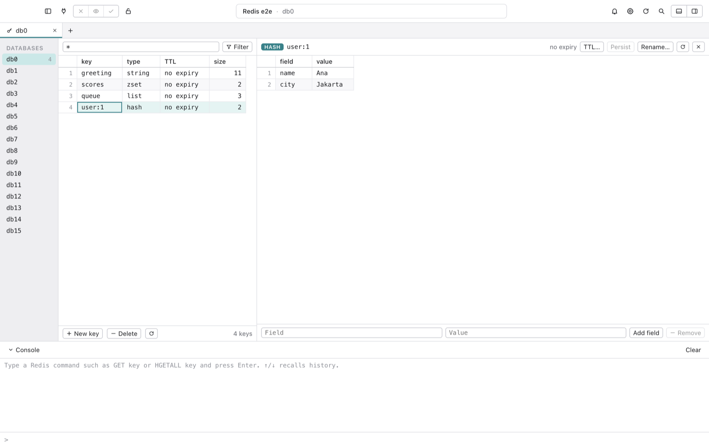
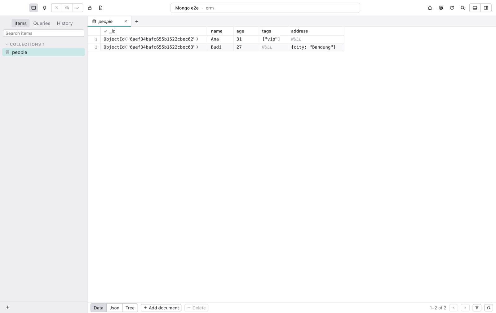

<p align="center">
  
</p>

<h1 align="center">Lagoon</h1>

<p align="center">
  <strong>A calm, fast database client for PostgreSQL, MySQL, MariaDB, SQLite, Redis and MongoDB.</strong>
</p>

<p align="center">
  <a href="https://github.com/ramdanegie/lagoon/releases"></a>
  
  
  
  <a href="LICENSE"></a>
</p>

<p align="center">
  English · <a href="README.id.md">Bahasa Indonesia</a>
</p>

---

Lagoon is a native-feeling desktop app for working with your databases. All your connections live in one window: open any database from the tree and work across several at once. Browse tables, edit rows inline, write SQL, change structure, import and export, back up, and watch your server, all from one quiet window.

Every change you make in the grid or the structure editor is **staged first**. You review the exact SQL, then commit it in one transaction, or throw it away. Safe mode adds a confirmation or a password before anything touches a production database.

Everything is free and open source. No account, no telemetry, no feature limits: unlimited tabs, windows, filters and dashboards.

<p align="center">
  
</p>

## Highlights

- 🌳 **One window, every database.** A connection tree on the left: connections → databases → schemas → tables. Double-click a database and it opens right there; tables and queries from different connections and databases sit side by side as tabs, each labelled with its database and keeping its own session.
- 🔌 **Connections that just work.** PostgreSQL, MySQL, MariaDB, SQLite, Redis and MongoDB. SSH tunnels with keys, `~/.ssh/config` and the SSH agent (host keys are pinned on first use), SSL/TLS with client certificates. Passwords live in the OS keychain, or are asked every time, or come from a shell command for short-lived tokens. Status colors, tags, nested groups, import from a URL, and encrypted export to share with your team.
- 📋 **A grid that stays smooth.** Virtualized rendering scrolls 10,000 rows at 120 fps. Edit inline: click a selected cell, press `F2` or `Enter`, or just type; each edited cell shows ✓ to keep and ✗ to cancel. A record bar below the grid adds (+) and removes (−) rows, then saves (✓) or discards (✗) everything. `⌘I` adds a row, `⌘D` duplicates, `⌫` deletes. Changes are colored (new, modified, deleted) until you press `⌘S`. Results of a `SELECT` from one table with its key can be edited and saved the same way. Pick foreign-key values from the parent table, find and replace across the page, save filter and column layouts as profiles. Undo and redo, a row detail sidebar that edits many rows at once, Quick Look for long text, JSON and images, follow a foreign key with one click, copy as CSV, JSON, Markdown, HTML or `INSERT` statements.
- 🔍 **Filters without limits.** Any column, every operator (`IN`, `BETWEEN`, `LIKE`, contains, prefix, `ILIKE` on Postgres…), "any column" search, raw SQL conditions, AND or OR, quick filters from a cell. Filters, sort, hidden columns and column widths are remembered per table.
- 🧱 **Structure editor.** Columns, types, defaults, primary keys, foreign keys with `ON UPDATE`/`ON DELETE`, indexes, triggers and the full DDL. Create tables, views, materialized views, functions and procedures. Everything is previewed as SQL before it runs.
- ⌨️ **A SQL editor you will like.** Run the statement under the cursor (`⌘↩`) or everything (`⇧⌘↩`), one result tab per statement, alias-aware autocomplete, JOIN suggestions from foreign keys, hover a table to see its columns, snippets with tab stops, multiple carets, Vim mode, beautify and uglify, query parameters in six styles, row limits, charts from any result, saved queries as plain `.sql` files with keyword shortcuts, and searchable history per connection.
- 🛡️ **Safe mode.** Five levels per connection, from silent to "password before every write". It covers the editor, grid commits, killing queries, backups and dashboards.
- 🧭 **Open Anything.** `⌘P` jumps to any table, view, function, database, saved query or feature. Plus search for a value across every table in the database.
- 🔄 **Sync and transfer.** Copy tables between connections, even across engines (PostgreSQL ⇄ MySQL ⇄ SQLite) or into a SQL file. Data sync compares rows by key, shows every difference cell by cell, and deploys only the rows you tick. Structure sync compares two schemas and writes the migration script for you, in dependency order.
- 🔬 **Visual Explain.** See the query plan as a tree, with the expensive steps highlighted and stats per step and per table. Explain Analyze runs writes inside a rolled-back transaction.
- 🧪 **Test data and docs.** Fill tables with realistic fake data that respects foreign keys (parents first), uniqueness and enums, with a preview and a seed. Export a data dictionary of your schema as HTML or Markdown.
- 🗺️ **ER diagram.** Tables, columns and foreign keys, grouped by color. Drag between columns to create a foreign key, then commit it like any other change.
- 📦 **Import, export, backup.** CSV, JSON and SQL import with column mapping and conflict handling. Export to CSV, JSON, SQL (gzip) and Excel. Backup and restore with `pg_dump`/`pg_restore` and `mysqldump`/`mysql`, with a live log.
- 📊 **Dashboards.** Metrics boards with tables, scoreboards, bar, line and pie charts, inputs, dropdowns and buttons wired together with `$variables`, auto refresh from 1 second to 30 minutes.
- 👥 **Server tools.** User and privilege management for PostgreSQL and MySQL, and a process list to find and kill slow queries.
- 🧰 **Redis and MongoDB, done properly.** Redis: every database index, key search, editors for strings, hashes, lists, sets, sorted sets and streams, TTL, and a command console. MongoDB: grid, JSON and tree views, staged edits, and a shell for `find`, `aggregate` and commands.
- 🧭 **Feature tour.** A short spotlight tour of the main parts of the window on first launch. Untick "Show this tour when Lagoon opens" to stop it, and replay it any time from Help ▸ Feature Tour.
- 🧩 **Make it yours.** JavaScript plugins, light and dark themes plus your own, font sizes, a keymap editor, and an app passcode lock.

<p align="center">
  
  
</p>
<p align="center">
  
  
</p>

## Light on your Mac

Lagoon is built on Electron, but tuned to stay small. Measured on an Apple Silicon Mac with `node test/perf/measure.mjs --compare` (memory as Activity Monitor reports it, all processes summed):

| | Idle | One 10,000-row table open | Scrolling |
|---|---|---|---|
| **Lagoon** | **126 MB** | 196 MB | 120 fps |
| Navicat Premium Lite 17.3.11 | 129 MB | – | – |

How: database drivers, SSH, Excel export, the SQL editor and charts load only when you first use them; the editor, charts and every dialog load only when you open them; the grid renders only the rows on screen; rasterizing on the CPU keeps the GPU process small without dropping frames. A native Swift app like TablePlus still uses less (about 60 MB idle); Lagoon trades a little memory for running on macOS, Windows and Linux from one codebase.

## Install

1. Download the latest release for your platform from [Releases](https://github.com/ramdanegie/lagoon/releases): `.dmg` for macOS, `.exe` for Windows, `.AppImage` for Linux.
2. macOS: open the DMG and drag **Lagoon** to **Applications**. Test builds are not notarized yet, so macOS cannot verify them: open **System Settings → Privacy & Security** and click **Open Anyway** (or run `xattr -dr com.apple.quarantine /Applications/Lagoon.app`).

No release yet? Build it yourself in two minutes (below).

**Requirements:** macOS 12 or later (Apple Silicon or Intel), Windows 10 or later, or a recent Linux desktop.

## Build from source

```bash
git clone https://github.com/ramdanegie/lagoon.git
cd lagoon
npm install
npm run dev          # run with hot reload
npm run build:mac    # or build:win / build:linux → dist/
```

Node 22 or later. `npm run icon` rebuilds every icon size from [`docs/design/Lagoon App Icon.html`](docs/design/Lagoon%20App%20Icon.html).

## Tests

```bash
npm test                         # unit tests: SQL generation, statement splitter, URLs, grants, import/export, plugins…
./test/e2e/fixtures.sh up        # throwaway Postgres, MySQL, Redis, MongoDB and SQLite (never touches your own servers)
npm run e2e                      # builds the app and drives it with Playwright
node test/e2e/engines.mjs        # one round trip per database engine
./test/e2e/fixtures.sh down
node test/perf/measure.mjs       # cold start, memory, scroll frame times
```

## Privacy

- Local only: no telemetry, no analytics, no account, no server. Lagoon only talks to the databases you connect to.
- Passwords are encrypted with the OS keychain (`safeStorage`) and never written to disk in plain text. If secure storage is unavailable, Lagoon refuses to save them.
- SSH host keys are remembered on first connect; a changed key blocks the connection.
- Plugins run with your permissions and can read and change your data. Only install plugins you trust.

## Keyboard shortcuts

| Action | macOS | Windows / Linux |
|---|---|---|
| Open Anything | `⌘P` | `Ctrl+P` |
| Open database / connection | `⌘K` / `⇧⌘K` | `Ctrl+K` / `Ctrl+Shift+K` |
| New SQL query | `⌘E` | `Ctrl+E` |
| Run current / all | `⌘↩` / `⇧⌘↩` | `Ctrl+Enter` / `Ctrl+Shift+Enter` |
| Commit / Preview / Discard | `⌘S` / `⇧⌘P` / `⇧⌘⌫` | `Ctrl+S` / `Ctrl+Shift+P` / `Ctrl+Shift+Backspace` |
| Filters / Columns | `⌘F` / `⌥⌘F` | `Ctrl+F` / `Ctrl+Alt+F` |
| Add row / Duplicate | `⌘I` / `⌘D` | `Ctrl+I` / `Ctrl+D` |
| Row details | `Space` | `Space` |
| Process list / cancel query | `⌘.` | `Ctrl+.` |
| Settings | `⌘,` | `Ctrl+,` |

Every shortcut can be changed in **Settings → Keymap**.

## Project layout

| Path | What is there |
|---|---|
| `src/main` | Electron main process: database drivers, SSH tunnels, local store (`node:sqlite`), jobs, plugins |
| `src/main/drivers` | PostgreSQL, MySQL/MariaDB, SQLite, Redis and MongoDB drivers |
| `src/shared` | Pure, tested logic: SQL generation per dialect, statement splitter, URL parser, grant SQL |
| `src/renderer` | The React UI: grid, editor, screens, themes |
| `plugins-examples` | Three example plugins to start from |
| `docs/design` | The app icon source (one HTML file renders every size) |
| `test` | Unit tests, Playwright end-to-end suites, fixtures and the performance probe |

## Contributing

Issues and pull requests are welcome, from bug reports to new database engines.

- Run `npm test` and `npm run typecheck` before opening a PR.
- Writes to a database always go through the staged-change flow or safe mode. Never add a path that sends a write without one.
- Keep SQL generation in `src/shared` with a test for every dialect it touches.

If Lagoon is useful to you, a ⭐ helps other people find it.

## Author

Made by **Egie Ramdan** · [github.com/ramdanegie](https://github.com/ramdanegie)

## License

[MIT](LICENSE)
